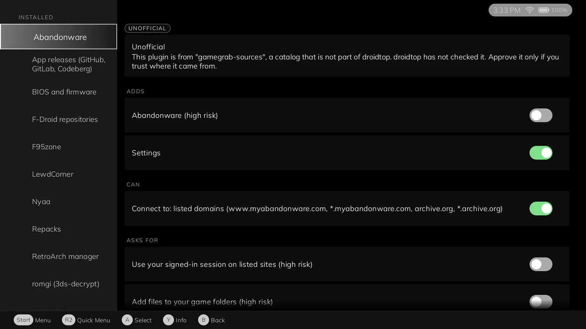
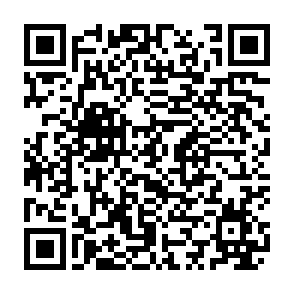

<h1 align="center">gamegrab-sources catalog</h1>

  <b>An unofficial plugin catalog for droidtop.</b> 
  Not part of droidtop. Every plugin in it is marked Unofficial and runs only after you approve it.

  
  
  
  

> ## Disclaimer
>
> This catalog is unofficial. It is not part of droidtop, and the droidtop project does not make, review or endorse it or the plugins it lists. The plugins listed here may enable access to content from unofficial sources. The catalog and its plugins are provided as is, without warranty of any kind. The maintainers are not responsible for how unofficial plugins are used, or for any content reached through them. You are responsible for complying with the law where you live and with the terms of the sites and services involved. Takedown requests and other concerns: https://github.com/gamegrab-sources/catalog/issues

The same text is in the index (`disclaimer`). droidtop shows it and asks you to accept it before it lists anything from this catalog.

  <a href="#add-it-to-droidtop">Add it</a> ·
  <a href="#whats-in-it">What is in it</a> ·
  <a href="#how-it-stays-safe">Trust</a> ·
  <a href="#takedown-and-contact">Takedown</a> ·
  <a href="#licence">Licence</a>

This catalog lists every droidtop plugin published in the [gamegrab-sources](https://github.com/gamegrab-sources) organisation, in one index file that [droidtop](https://github.com/Droidtop/droidtop) can read.

  
   droidtop marks every plugin from this catalog Unofficial, and shows the notice before you approve it.

## Add it to droidtop

Open this link on the device that has droidtop, or scan the code with its camera:

**[Add this catalog to droidtop](https://droidtop.github.io/add-catalog?address=https%3A%2F%2Fgithub.com%2Fgamegrab-sources%2Fcatalog)**

The page it opens shows the catalog address and an "Open in droidtop" button, with a "Copy address" fallback. droidtop then fetches the index, shows the catalog's name, its disclaimer, its root key and the key of every origin it lists, and adds nothing until you accept.

Inside droidtop, the same flow is **Settings > Plugins > Add > More catalogs**, where this catalog is listed to switch on. You can also use "Read a QR code" on a screenshot of the code above, or type the address:

    https://github.com/gamegrab-sources/catalog

## What is in it

Each plugin has its own repository, description and licence, and each one's description says it is not part of droidtop. Every plugin still runs only after you approve what it asks for.

| Plugin | What it does |
|---|---|
| Abandonware | Searches MyAbandonware and the Internet Archive |
| BIOS and firmware | Finds the BIOS, firmware and key files your emulators ask for |
| F95zone | Links your games to their F95zone threads and checks for updates |
| LewdCorner | Links your games to their LewdCorner threads and checks for updates |
| Nyaa | Searches the games categories of Nyaa and hands torrents to a torrent app |
| Repacks | Finds FitGirl, DODI and ElAmigos releases and checks for updates |
| romgi | The romgi game index, in several variants |

Read each plugin's own description in droidtop before you install it. None of them is affiliated with the sites it works with.

You can also browse the catalog on the web, with each plugin's permissions in plain language and an "Install in droidtop" button: <https://gamegrab-sources.github.io/catalog/>. The page opens with this disclaimer.

## How it stays safe

- The catalog's own signing key is shown when you add it, and droidtop refuses a later copy of the index that names another one.
- Each plugin is a signed bundle, checked on your device before it runs.
- A plugin's certificate or key can be revoked, and droidtop then stops it on every device that has this catalog.
- These plugins are never "Official" in droidtop. Their keys are certified by the gamegrab root, a separate anchor that you choose to trust, not droidtop's own.

The index format, the signing chain and the revocation list are in [docs/CATALOG-FORMAT.md](docs/CATALOG-FORMAT.md).

## Takedown and contact

Open an issue: https://github.com/gamegrab-sources/catalog/issues. A plugin can be removed from the index, and its certificate or key revoked, so droidtop stops it on every device that has this catalog.

## History

Changes to the tooling are in [CHANGELOG.md](CHANGELOG.md) and tagged as releases. Every change to the index is a commit on `main`.

## Licence

The tooling and documentation in this repository are GPL-3.0 licensed, see [LICENSE](LICENSE). Each listed plugin has its own repository and licence.
